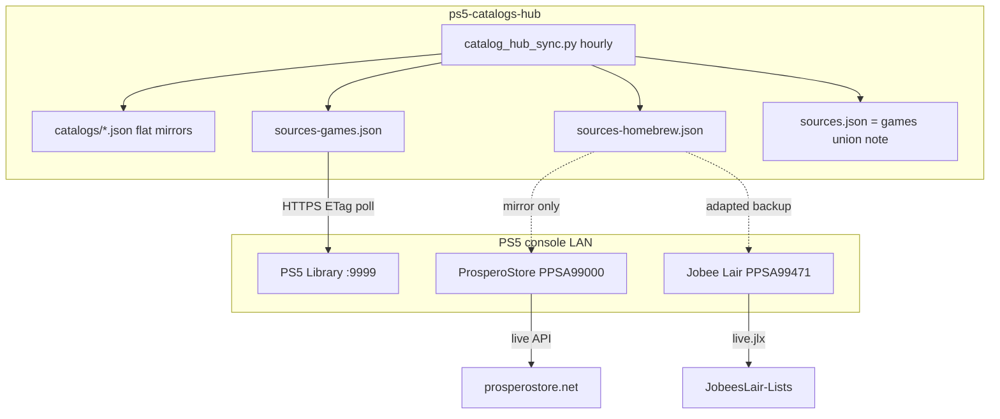

# Design: Game vs Homebrew Catalog Separation (#1)

**Date:** 2026-11-14  
**Status:** Approved (user: approve #1)  
**Repos:** `AICyberGuardian/ps5-catalogs-hub`, console `<console-lan-ip>`

## Goal

Separate commercial game dumps from homebrew install/update paths so each surface does one job, while keeping hourly hub mirrors for resilience.

## Decision (Approved)

| Consumer | Role | Feeds |
|---|---|---|
| **PS5 Library** (`:9999`) | Gigabit game dumps (AllDebrid, Rest Mode) | Games only |
| **ProsperoStore** (`PPSA99000`) | Official signed homebrew install/update | Live `prosperostore.net` (hub mirror for backup/docs) |
| **Jobee'sLair** (`PPSA99471`) | Scene / extra homebrew Prospero does not ship | Jobee live.jlx + hub adapted Jobee JSON as backup |

**Rejected:** Keep Jobee homebrew in PS5 Library. **Rejected:** Deploy Overdrive/Orbit/Pegasus solely for leftover homebrew.

## Hard Constraints

1. ProsperoStore does **not** accept custom hub catalogs; it only uses darkxex signed prosperostore.net.
2. Do not break existing raw GitHub catalog URLs under `catalogs/*.json` (flat paths stay).
3. Dual-boot invariant: never create `/data/ps5_autoloader/`.
4. Hub sync remains content-idempotent (no timestamp churn commits).
5. Catalog JSON upstream ownership unchanged; hub tooling Apache-2.0 only.

## Hub Architecture

### Feed classification

**Games (Library):**

- `dlps.json`, `zer0.json`, `pippo.json`, `pfs.json`
- `blackbox_catalog.json`, `jamzi94-ps5.json`, `pegasus-ps4-catalog.json`

**Homebrew (not Library sources):**

- `prosperostore.json` — canonical Prospero catalog mirror
- `homebrew-page.json` — keep syncing as **alias** of Prospero feed for URL stability; stop advertising as a separate Library source
- `jobeeslair-homebrew.json` — adapted Jobee index; hub backup / optional tooling; not a Library source

### Manifests

- `sources-games.json` — only game feeds; this is what Library migration scripts consume
- `sources-homebrew.json` — `prosperostore` + `jobeeslair-homebrew` with `consumer` hints (`prospero-native` / `jobee-native`)
- `sources.json` — retain for compatibility: game sources primary; document that homebrew entries are mirrors only, not Library targets

### Sync script changes

- Tag each `Feed` with `kind: "game" | "homebrew"`
- `write_manifest()` emits all three JSON files
- README documents the three-consumer model
- No physical `catalogs/games/` move (avoids breaking existing console URLs)

## Console Architecture

1. **Deploy** ProsperoStore `PPSA99000` v1.000.116 to `/data/homebrew/PPSA99000/` (internal NVMe), SMP rescan.
2. **Remove** from PS5 Library catalog sources: mislabeled Prospero/homebrew feed and Jobee adapted feed.
3. **Keep** Library on hub game HTTPS URLs only (7 game feeds).
4. **Jobee'sLair** remains on NVMe; launch once for live.jlx if needed. Do not re-add Jobee JSON to Library.

## Success Criteria

- Library indexed sources = 7 game feeds, 0 homebrew sources, 0 failures
- ProsperoStore registered in SMP as `PPSA99000`, launchable from home screen
- Hub `sources-games.json` lists only games; `sources-homebrew.json` lists Prospero + Jobee
- Hourly CI still green; back-to-back sync produces no empty churn commits
- Dual-boot path `/data/ps5_autoloader/` still absent

## Out of Scope

- Restoring Overdrive / Orbit / Pegasus
- Injecting custom catalogs into ProsperoStore
- Gigabit debrid tuning (already configured)
- Moving catalog files into subdirectories
