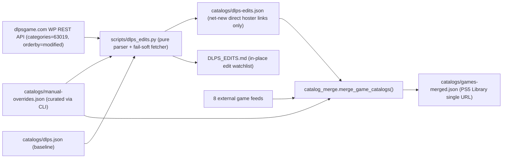

# Design: Zero-Bypass DLPS In-Place Edits Overlay, Watchlist & Manual Overrides

**Date:** 2026-11-28  
**Status:** Approved (Approach 1)  
**Repo:** `AICyberGuardian/ps5-catalogs-hub`

## Problem

Upstream `pegasus-dl.dev/catalogs/dlps.json` crawls newly published `dlpsgame.com` posts reliably, but rarely re-scrapes in-place edits (`modified > date`) on older posts. Meanwhile, `Jamzi94/catalog-V2`'s WP-API redirect resolver fails when `downloadgameps3.net/archives/*` returns a Cloudflare Managed Challenge (`HTTP 403` / `cf-mitigated: challenge`).

Live audit of the 30 most recently modified PS5 posts on `dlpsgame.com`'s open WordPress REST API (`categories=63019&orderby=modified&order=desc`, HTTP `200`, zero anti-bot challenge):
- **26 / 30** are in-place edits of older posts.
- **17 / 26** contain **136 unindexed direct file-hoster links** already readable inside base64 `.secure-data` blocks with no redirector hop.
- **9 / 26** (including `Alan Wake 2 PPSA02572 v01.200.009`) have new links behind `downloadgameps3.net/archives/*`.

## Hard Constraints

1. **Zero anti-bot / CAPTCHA bypass:** Never request or attempt to solve Cloudflare challenges on `downloadgameps3.net`. Only read the open `dlpsgame.com` WordPress REST API (`HTTP 200`) and extract direct file-hoster links.
2. **Flat catalog URLs & consumer split intact:** Do not break existing `catalogs/*.json` URLs, do not alter `sources-games.json` (remains the 8 external upstream feeds), and never inject homebrew into game catalogs.
3. **Content-idempotency (zero churn commits):** Neither `catalogs/dlps-edits.json` nor `DLPS_EDITS.md` may rewrite files when semantic content is unchanged.
4. **Fail-soft external polling:** If `dlpsgame.com`'s WP REST API is unreachable or rate-limited during an hourly run, carry over the previous `catalogs/dlps-edits.json` and log a warning without failing the sync exit code.
5. **Zero new runtime dependencies:** Python 3.12 stdlib only (`base64`, `html`, `json`, `re`, `urllib`).

## Architecture

### Component 1: `scripts/dlps_edits.py` (Auto Direct-Link Delta Overlay + Watchlist)
- **Fetching:** Fetches up to 2 pages (`per_page=100`, max 200 most recently modified PS5 posts) from `https://dlpsgame.com/wp-json/wp/v2/posts?categories=63019&orderby=modified&order=desc`. Uses minimal `_fields=id,date,modified,slug,link,title,content`.
- **Per-block parsing (prevents cross-region Title ID leakage):**
  - Decodes every `
` block independently.
  - Resolves each block's `titleId` (`PPSA\d{5}` / `CUSA\d{5}`) from the block text first, then the nearest preceding heading, then post-wide fallback; skips blocks with no valid Title ID.
  - Extracts `version` (e.g. `01.200.009`), `region` (`EUR`/`USA`/`JPN`/`ASIA`), `password`, direct hoster links (strict allowlist of file-hoster domains; excludes `downloadgameps3.net`, `clk.sh`, social/NFO links), and counts gated `downloadgameps3.net` links.
- **Delta filtering (`build_dlps_edits`):**
  - Compares extracted direct hoster links against existing `(titleId, url)` pairs across **all 8 synced game feeds** (`GAME_MERGE_ORDER`), not only `dlps.json`.
  - Emits only truly net-new direct links into Pegasus-schema `catalogs/dlps-edits.json`, reusing existing `posterUrl` from the baseline catalogs when available.
  - Deterministic sorting (`titleId`, `version`, `title`) and no volatile timestamp field → 100% content-idempotent.
- **Watchlist generation (`render_watchlist_markdown`):**
  - Tracks in-place edited posts (`date[:10] != modified[:10]`) ordered by `modified` descending (capped to top 50 rows).
  - Status per edited post:
    - `OVERRIDDEN` — matching `(titleId, latestVersion)` present in `catalogs/manual-overrides.json`
    - `PARTIAL` — latest block is gated behind `downloadgameps3.net` and missing from all 8 feeds, while older/sibling blocks contributed net-new direct links
    - `NEEDS_MANUAL` — latest block has `downloadgameps3.net` links, is missing from all 8 feeds and `manual-overrides.json`, and no net-new direct links were auto-added
    - `AUTO_ADDED` — net-new direct hoster links captured in `catalogs/dlps-edits.json` (and latest block is not gated-missing)
    - `COVERED` — latest block already indexed in any of the 8 game feeds (or no gated-only gap)
  - Idempotent file writer compares body without timestamp header (only writes `DLPS_EDITS.md` when table rows change).

### Component 2: `catalogs/manual-overrides.json` + `scripts/add_manual_override.py`
- Committed Pegasus-schema catalog (`{"name": "AICyberGuardian PS5 Manual Overrides", "version": 1, "packages": []}`).
- CLI helper `scripts/add_manual_override.py` supports:
  - `add --title-id PPSA02572 --title "Alan Wake 2 Deluxe Edition" --version 01.200.009 --region EUR --password DLPSGAME.COM --link "Akia=https://..." --link "Viki=https://..."`
  - `remove --title-id PPSA02572 [--version 01.200.009]`
  - `list`
- Strict input validation:
  - Enforces `^(PPSA|CUSA)\d{5}$` Title ID format.
  - Enforces `https?://` URLs and **rejects** known redirector/shortener hosts (`downloadgameps3.net`, `downloadgameps3.com`, `dlpsgame.com`, `clk.sh`, `ouo.io`, `shrinkearn.com`) so unresolved links can never pollute PS5 Library.
  - Upserts cleanly by `(titleId, version)` and sorts deterministically.

### Component 3: Hub Sync & CI Integration
- `scripts/catalog_hub_sync.py`:
  - Adds `build_dlps_edits()` (fail-soft with carry-over from existing `catalogs/dlps-edits.json`) and writes `DLPS_EDITS.md` idempotently.
  - Defines `OVERLAY_MERGE_PREFIX = (("manual-overrides.json", "manual-overrides"),)` and `OVERLAY_MERGE_SUFFIX = (("dlps-edits.json", "dlps-edits"),)` merged in `build_merged_games()` so:
    1. `manual-overrides` has highest priority (curated labels/versions win).
    2. All 8 external feeds follow in `GAME_MERGE_ORDER`.
    3. `dlps-edits` supplies any remaining net-new direct links from edited `dlpsgame.com` posts.
  - Keeps `sources-games.json` strictly on the 8 external feeds; records active overlays in `sources-merged.json` (`overlays` / `replaces`) and `SYNC_REPORT.md`.
- `.github/workflows/sync-catalogs.yml`: adds `DLPS_EDITS.md` to `git add`.

## Success Criteria

- `python -m unittest discover -s tests -v` passes with full offline tests for `dlps_edits.py`, `add_manual_override.py`, and `catalog_hub_sync.py`.
- Live `python scripts/catalog_hub_sync.py` succeeds with `failures=0`, populates `catalogs/dlps-edits.json` with net-new direct links from edited posts, generates `DLPS_EDITS.md` highlighting `PPSA02572 v01.200.009` as `NEEDS_MANUAL`, and merges cleanly into `catalogs/games-merged.json`.
- Immediate second `python scripts/catalog_hub_sync.py` produces zero file modifications (100% content-idempotent).
